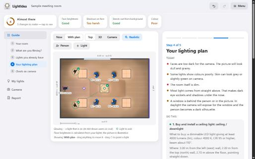
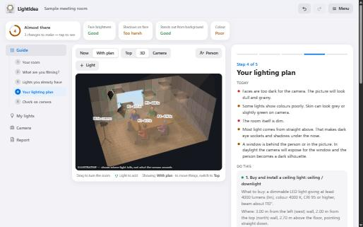

# LightIdea

**Light your video like a studio.** LightIdea plans and checks the lighting for video calls, interviews and recordings. You describe your room; it tells you what to change, what to buy and where to put it. No lighting knowledge is needed.

It is free, works offline, and runs entirely in your browser. Nothing is uploaded and there is no account.

| The plan from above | The same room in 3D |
|---|---|
|  |  |

## What it does

- **Finds the problems.** Faces too dark, flat or harsh shadows, mixed warm and cool lamps, a window behind the speaker. Each one is explained in plain words.
- **Gives you a plan.** A numbered to-do list: re-aim the lights you already own first, then what to buy, where to mount it, where to point it and how bright to set it.
- **Shows the result.** A top-down plan, a realistic view of light on the floor, a 3D view you can turn, and a view from the camera's position.
- **Checks with your camera.** Take a test photo and the app points out burnt-out areas, lost shadows and uneven faces.

## How to use it

1. **Describe your room.** Measure the length, width and ceiling height and type them in.
2. **Say what you are filming.** Pick the closest match. People and camera are placed for you; drag them to where they really are.
3. **Add the lights you already have.** Drag each to its place and copy lumens (how bright) and Kelvin (how warm or cool) from the lamp or its box.
4. **Follow the lighting plan.** Read what is wrong today, then work through the to-do list.
5. **Check on camera.** Set the camera as suggested, take a test shot in the Camera tab, and fine-tune the dimmers.

## Put it on an iPhone

1. Open the app page (`LightIdea.html`) in Safari.
2. Tap Share, then **Add to Home Screen**.
3. Open it once from the new icon while online. After that it works with no connection.

Projects are saved inside the browser or the home-screen app. Use **Save project file** in the menu for a backup.

## Files

| File | Purpose |
|---|---|
| `index.html` | Introduction page shown at the site's root address |
| `LightIdea.html` | The app. It also works on its own when opened from disk |
| `manifest.webmanifest` | App name, icon and full-screen settings for installing |
| `sw.js` | Offline cache |
| `icons/` | App icons |
| `screenshots/` | Pictures used on the introduction page and in this file |

To host it, upload all of these to any static HTTPS host, such as GitHub Pages, keeping the folders as they are. There is no build step.

## Limits

- It is a planning tool: a careful estimate, to be confirmed with a test recording.
- The pictures show where light falls. They are illustrative, not a camera preview.
- Daylight from windows is flagged but not calculated, so close the blinds when filming.
- Room lighting targets follow EN 12464-1. The video targets are practice guidelines, not a standard.

Expert mode, in the app's menu, shows every number, formula and assumption, and includes a self-test of the calculations.

## Credits

Designed and developed by **Jerin**.
